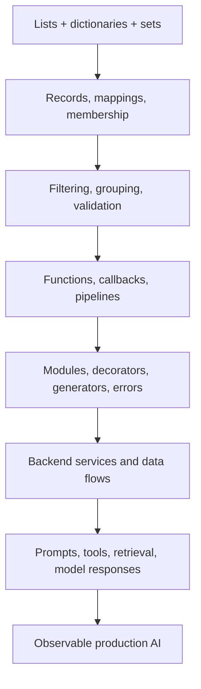

<p align="center"></p>

<p align="center">
  
  
  
  
</p>

<p align="center"><i>A living learning lab for building Python intuition, one small system at a time.</i></p>

---

## 📊 Journey Dashboard

<!--DASH:START-->
<!--DASH:END-->

> Edit `journey.json`, push, and the dashboard, map, and book below rebuild automatically. See [How to update](#-how-to-update).

## 🗺️ Learning Map

<!--MAP:START-->
<!--MAP:END-->

## 📂 Explore the Tracks

Every folder has its own README with the chapters, the topics inside each chapter, and what each one is for. Start with `01-python`, then follow the numbers.

<!--AREAS:START-->
<!--AREAS:END-->

## 📖 The Book: Chapters, Topics, Subtopics

Every chapter lists what was covered, and where that idea shows up later in **AI or backend engineering**.

<!--BOOK:START-->
<!--BOOK:END-->

## 🧪 Projects and the Concepts They Use

<!--PROJECTS:START-->
<!--PROJECTS:END-->

## 🧠 The Core Mental Model



| Python idea | Becomes |
| --- | --- |
| Dictionary mapping | Authorization |
| Filter | Metadata retrieval |
| Generator | Streaming |
| Decorator | Logging / tracing |
| Exception handler | Resilient processing |
| Function passed as data | Model or tool strategy |

## 🧭 Repository Guide

```text
.
├── 01-python/              core language: basics → OOP → intermediate → exercises → projects
├── 02-backend/             HTTP, FastAPI, databases, auth, testing, deployment
├── 03-ml-foundations/      NumPy, pandas, model basics
├── 04-llm-rag-agents/      LLM APIs, embeddings, RAG, agents, evaluation
├── docs/                   mental models, mental bridges, prompts
├── scripts/                build_readme.py (regenerates the READMEs)
├── assets/                 header and dashboard images
└── journey.json            the single source of truth for progress
```

- [Python mental models](docs/mental-models/python_mental_models.md): the ideas behind the progression
- [Mental model map](docs/mental-models/python_mental_model_map.md): syntax to systems
- [Mental bridges](docs/mental-bridges/README.md): realistic scenarios that connect small patterns to real systems

Run any file from the repo root, for example:

```bash
python 01-python/05-applied-exercises/01_zip_dictionary_mapping.py
```

## 🔄 How to update

1. Change a topic's `status` in `journey.json` to `done`, `wip`, or `todo` (`wip` counts as half).
2. Add a topic to a chapter's `topics` list. File paths are written from the repo root; use `also` for extra files:
   ```json
   {"name": "Generators", "status": "done", "subtopics": ["`yield`"],
    "future": "Streaming tokens", "file": "01-python/04-intermediate/06_generators.py"}
   ```
3. Add a chapter under a track's `chapters` with its `folder`, e.g. `"folder": "02-backend/02-fastapi"`. It appears automatically in that folder's README.
4. Add a project under `projects`. Each `concepts` entry must match a topic name exactly:
   ```json
   {"name": "Tool router", "path": "04-llm-rag-agents/projects/tool_router", "status": "building",
    "concepts": ["Inheritance", "10 Error-handling pipeline"]}
   ```
5. Run `python scripts/build_readme.py` locally, or just push: the GitHub Action does it for you. The script prints warnings for files that are missing or not listed in `journey.json`.

## ⭐ North Star

```text
Learn a concept. Use it in a realistic problem.
Recognize the larger system it belongs to. Build the next layer.
```